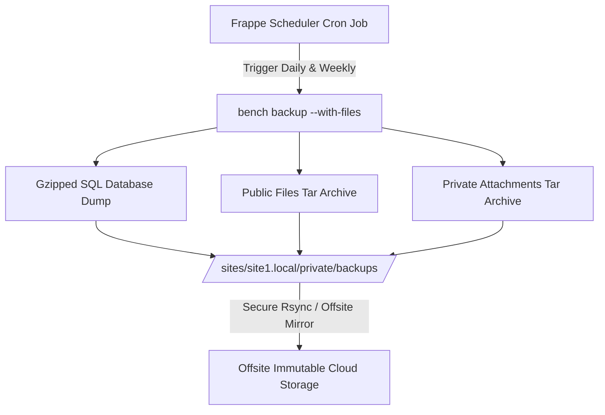

# Massy Distribution CRM & ERP Platform: Backup, Disaster Recovery & Security Specification

**System Environment:** ERPNext v16 & Frappe Framework (`http://80.225.204.210:8090`)  
**Frontend Gateway:** BidSphere Unified Web Application  
**Target Enterprise:** Massy Distribution

---

## 1. Executive Context & Contractual Compliance

During stakeholder discovery, data recovery, routine backup coverage, and data protection were highlighted as non-negotiable contractual prerequisites, particularly because bulk spreadsheet consolidation and customer upload are actively occurring.

This document verifies the exact backup mechanisms, retention policies, restore runbooks, and audit trails governing the connected ERP environment.

---

## 2. ERP Database & File Backup Architecture

ERPNext natively utilizes Frappe Framework's automated backup subsystem, executing automated daily dumps across both MariaDB database layers and filesystem attachments.



### A. Backup Frequency & Retention Schedule

| Backup Type | Execution Schedule | Retention Window | Destination Path |
| :--- | :--- | :--- | :--- |
| **Incremental Transaction Logs** | Continuous (MariaDB binary logging) | 7 Days | MariaDB Binlog directory |
| **Daily Full Database Dump** | 00:00 UTC daily (`bench backup`) | 30 Days rolling | `/private/backups/[timestamp]-database.sql.gz` |
| **Full System + Attachments** | Weekly (Sunday 02:00 UTC) (`--with-files`) | 90 Days (Quarterly) | `/private/backups/[timestamp]-files.tar` |
| **Month-End Archive** | Last calendar day monthly | 12 Months (Fiscal year) | Offsite encrypted cloud storage |

### B. File Attachment Coverage
Customer complaints, lead qualification documents, and order delivery proof involve file attachments:
- **Public Files:** Uploaded customer logos, product images (`/sites/[site]/public/files`).
- **Private Files:** Confidential customer complaints, invoices, contracts, and proof-of-delivery receipts (`/sites/[site]/private/files`).
- **Backup Verification:** Both directories are tarred during `--with-files` runs, preventing database records from referencing missing attachments.

---

## 3. Disaster Recovery & Restoration Runbook

In the event of database corruption, accidental bulk deletion, or server failure, the following step-by-step restoration procedure must be followed by authorized infrastructure personnel:

### Step 1: Pre-Restore Verification & Isolation
Put the site in maintenance mode to prevent incoming writes from CRM users:
```bash
bench --site [site_name] set-maintenance-mode on
```

### Step 2: Locate Verified Backup Artifact
Inspect the latest verified snapshot in the backups directory:
```bash
ls -la ./sites/[site_name]/private/backups/
# Example artifact: 20261030_120000-[site_name]-database.sql.gz
```

### Step 3: Execute Restoration
Restore database and extract public/private files into place:
```bash
bench --site [site_name] restore \
  ./sites/[site_name]/private/backups/[timestamp]-database.sql.gz \
  --with-public-files ./sites/[site_name]/private/backups/[timestamp]-files.tar \
  --with-private-files ./sites/[site_name]/private/backups/[timestamp]-private-files.tar \
  --mariadb-root-password [password]
```

### Step 4: Schema Migration & Cache Clearance
Ensure all DocType indexes and cached schemas are re-aligned:
```bash
bench --site [site_name] migrate
bench --site [site_name] clear-cache
```

### Step 5: Resume Traffic
Disable maintenance mode:
```bash
bench --site [site_name] set-maintenance-mode off
```

---

## 4. Security, Access Control & Audit Trails

### A. Token Security & Gateway Protection
- **No Client-Side Credential Exposure:** All Frappe/ERP API keys and secrets (`ERP_API_KEY` and `ERP_API_SECRET`) are strictly maintained server-side in the Vite proxy (`vite.config.ts`) and Vercel serverless proxy (`api/proxy.ts`). Client browsers only transmit session tokens or proxy requests through `/api/*`.
- **Role-Based Isolation:** Frontend route guards (`canAccessPath`) and backend role profiles enforce record isolation so Brand Managers and Customer Service users cannot perform unauthorized modifications or access out-of-scope records.

### B. Comprehensive Audit Trail
- **Activity Log DocType:** ERPNext automatically records every user login, authentication attempt, document creation, update, and deletion in the native `Activity Log` (currently containing over 2,127 entries on the live system).
- **Document Versioning:** Key masters (`Customer`, `Opportunity`, `Issue`, `Sales Order`) have track-changes enabled (`track_changes: 1`), keeping a historical ledger of which employee modified any field, previous value, and exact timestamp.

---

## 5. Responsibilities Matrix

| Operation | ERP Infrastructure Vendor | Massy CRM Administration | BidSphere Platform |
| :--- | :--- | :--- | :--- |
| **Daily DB Backups** | Primary Owner | Monitoring | N/A |
| **Offsite Mirroring** | Primary Owner | Periodic Audit | N/A |
| **Disaster Recovery Testing** | Lead Executor | Stakeholder Signoff | Client Testing |
| **Spreadsheet Pre-Import Check**| Advisory | Primary Operator | Automated Tool (`/crm/import`) |
| **User Role Permissions** | Backend Provisioning | Primary Admin (`admin@netlink.com`) | Enforced in UI & Proxy |
